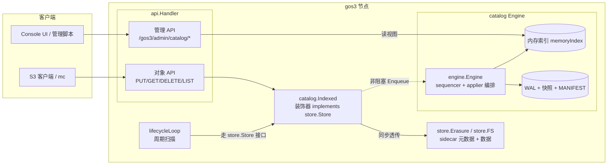
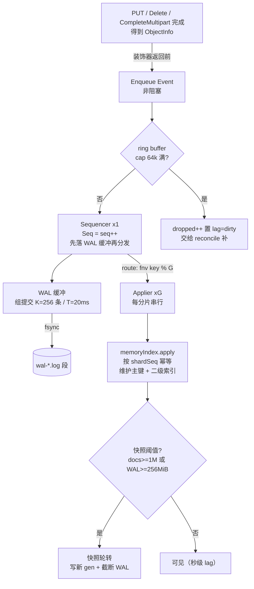
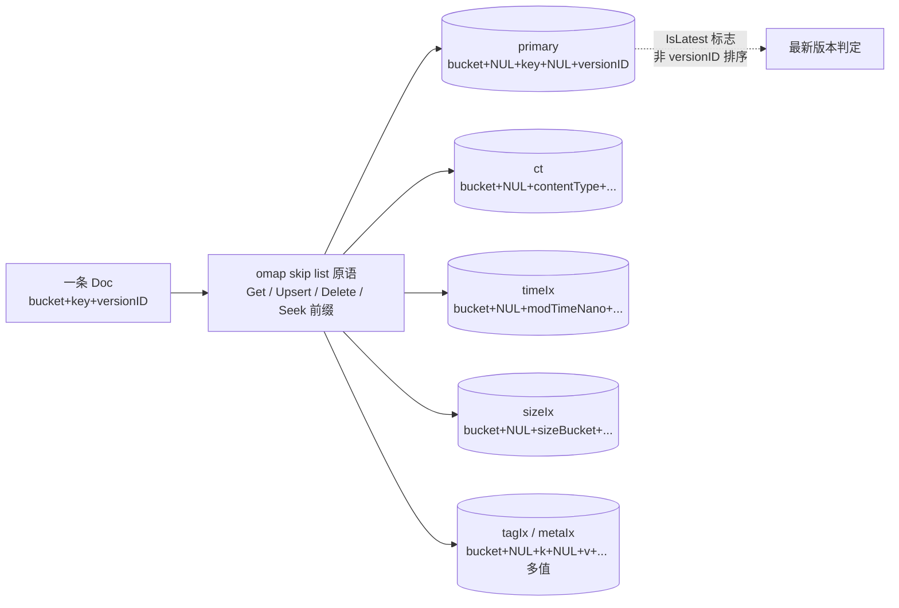
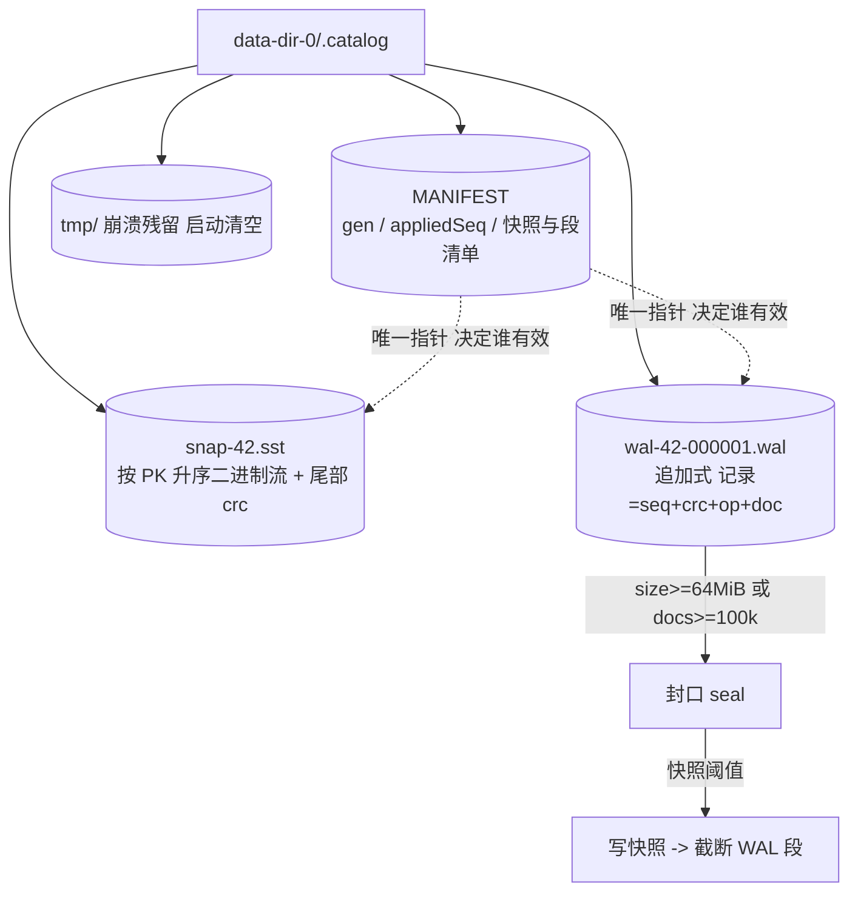
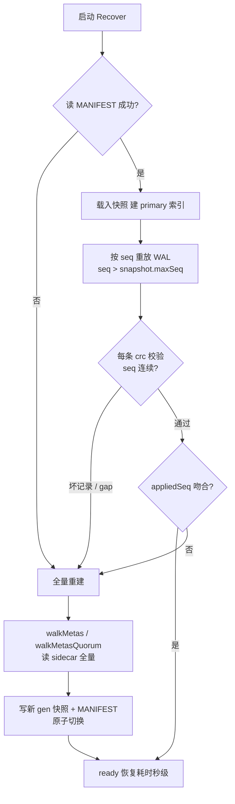
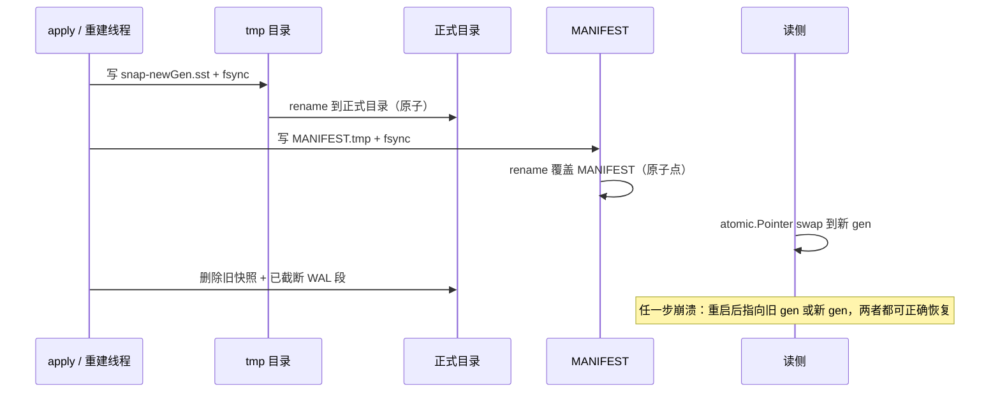
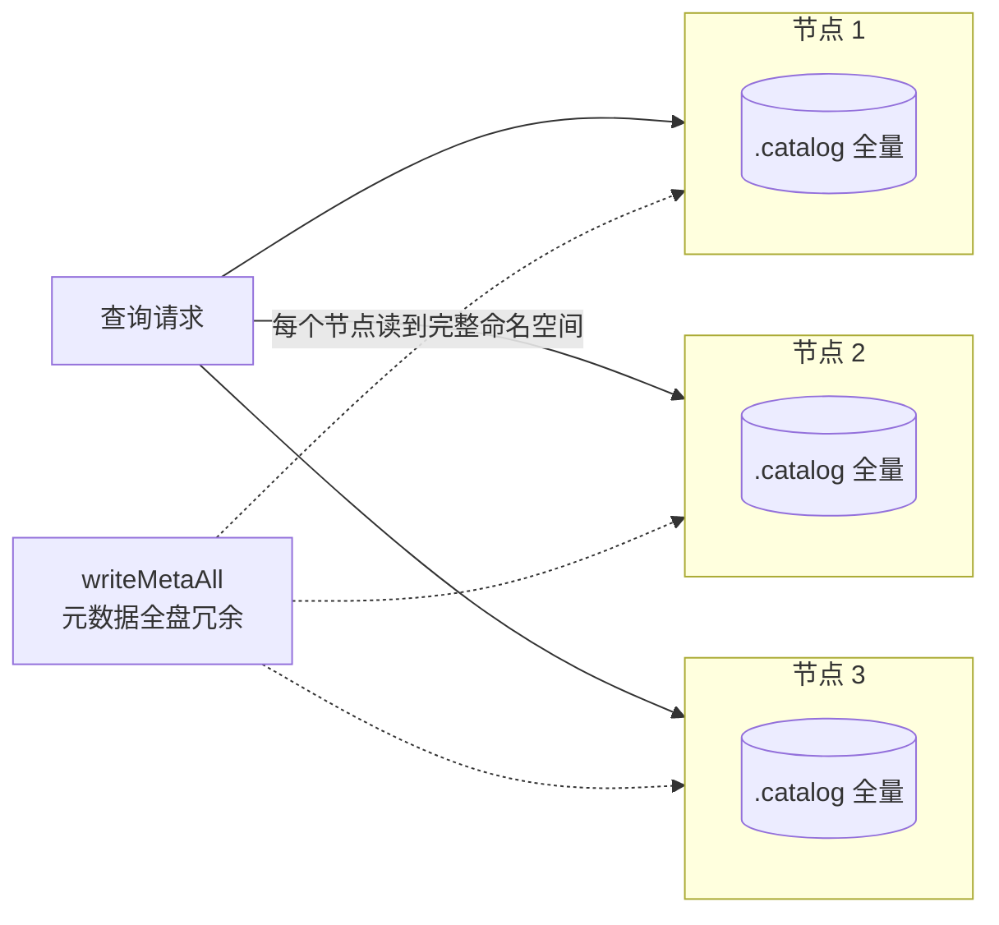

# gos3 · 元数据存储引擎 架构图

> 配套文档：docs/metadata-catalog.md（总体设计）、docs/catalog-storage-engine.md（引擎层深挖）。
> 图例：实线=同步调用/数据流，虚线=异步，圆角框=进程/服务，菱形=决策，圆柱=持久化。

---

## 图 1 · 总体挂载：Catalog 如何插进现有 gos3

- `catalog.Indexed` 内嵌 `store.Store`，未覆盖的方法原样透传；只拦写类方法投递事件。
- 生命周期扫描器 `lifecycleLoop` 收到装饰后的 store，删除自动入索引，无需额外埋点。
- 查询走 `HA -> MEM` 只读路径，**不回表 sidecar**。

---

## 图 2 · 写路径：从 PUT 到索引可见

关键顺序：**先 WAL 缓冲、再分发 apply**，保证任意时刻「WAL 的 seq 前缀 >= 已 apply 的 seq」，
可见性先于持久化（apply 不等 fsync），崩溃丢尾由 reconcile 补。

---

## 图 3 · 内存索引：一个 skip list 原语，五个实例

- 所有索引是**同一个 `omap`（skip list）的实例**，键统一 `[]byte`、NUL 分隔，查询=前缀范围扫描。
- 主键与二级索引存的是**同一个 `*Doc` 指针**，不复制；更新时用旧 Doc 反查摘除旧二级条目。
- `IsLatest` 是布尔字段（对应 sidecar `fsMeta.Versions[0]`），versionID 是随机 hex，不能当排序依据。

---

## 图 4 · 磁盘布局与文件生命周期

- MANIFEST 是唯一真相指针，tmp+rename 原子写（复用 `writeJSONFile` 思路）。
- WAL 记录带 crc32；坏记录/gap 在恢复时触发全量重建，不试图修复。

---

## 图 5 · 启动恢复决策树

---

## 图 6 · 原子切换协议（快照/重建共用）

---

## 图 7 · 集群形态：每节点全量索引

因为 `writeMetaAll` 把对象 meta 写到所有盘，每个节点本就拥有完整命名空间，索引无需分片/Raft；
代价是索引写放大 xN（只是元数据，可接受）。查询打任意节点答案一致（允许秒级 lag）。

> **实现备注（C4 后）**：图 7 是目标形态，当前尚未实现跨节点事件复制/reconcile。
> 每个节点的 `Indexed` 只收到本节点 API 写入的事件；节点 A 写入、节点 B 查询时，
> B 的索引不会自动更新（只有 B 启动时从 sidecar 全量重建可补历史）。该问题属于 C6。
> 另外，当前 applier 是单队列单 worker，图 2 的 `Applier xG` 是后续优化目标。

---
