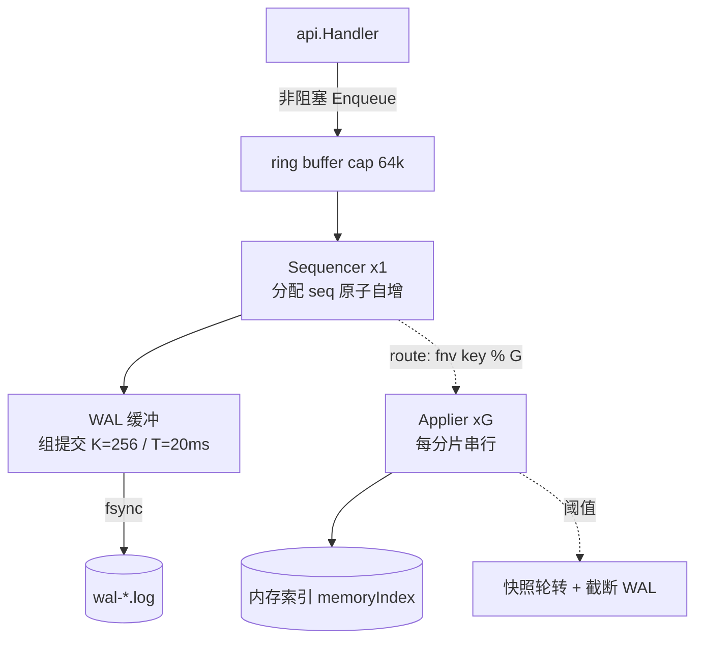

# gos3 · 元数据存储引擎设计（Catalog 引擎层）

> 本文是 docs/metadata-catalog.md（Catalog 总体设计）的引擎层深挖：只回答「元数据怎么存、
> 怎么写、怎么恢复」这一件事。查询规划、SQL 子集、管理 API、集群形态沿用总体设计，不在本文重复。
>
> 一句话定位：这是一个退化的 LSM —— 内存有序结构（memtable）+ 段式 WAL（写前日志）+
> 全量快照（唯一的 SSTable 层）。不引入 Pebble/Badger，Index 接口预留换引擎的退路。
>
> 所有引用到的代码事实均核对过当前仓库：Store 接口见 internal/store/store.go，
> sidecar 元数据见 internal/store/fs.go 的 fsVersion/fsMeta，全盘冗余写见
> internal/store/erasure.go 的 writeMetaAll，quorum 读取见 internal/store/quorum.go。

---

## 1. 模块边界

引擎层只关心三件事，其余划到别的层：

~~~
internal/catalog/
  engine/        <- 本文（存储引擎）：WAL + 快照 + 内存索引 + 恢复
  doc.go         <- 共享类型（Doc/Key/Event）——引擎与查询层都要用，放 catalog 根包
  store.go       <- Indexed 装饰器（产生 Event，调 engine.Append）
  query.go       <- 查询规划（读引擎的索引）
  sql.go         <- SELECT 子集
  api.go         <- /gos3/admin/catalog/*
~~~

依赖方向：store.go -> engine -> doc，query.go -> engine。engine 不依赖 store/api，可独立单测、
独立做 crash 测试。这是本设计最重要的分层约束——引擎的可测试性来自它不碰 S3 语义。

---

## 2. 为什么这就是一个 LSM（以及为什么不做完整版）

先把用户前面问的「要不要用 LSM 框架」在这里收口：

| 标准 LSM 组件 | 本设计对应物 | 说明 |
| --- | --- | --- |
| MemTable（写缓冲） | 内存有序索引（skip list） | 最新数据先落内存 |
| WAL（写前日志） | wal-<gen>-<seg>.wal | 保证重启不丢已 apply 的写入 |
| SSTable（落盘有序段） | snap-<gen>.sst 全量快照 | 只有一层，不做多层 |
| Compaction（合并） | 快照轮转：内存索引刷盘 -> 截断 WAL | 全量重建而非增量归并 |

为什么只有一层、不做多级 compaction / Bloom filter：

1. 索引是旁挂派生数据，随时可全量重建，没有「丢一层就丢数据」的问题——LSM 的多层设计
   是为「数据本身不可重建」服务的，这里用不上。
2. 元数据单条体积小（几百字节），全量快照成本可接受；多级归并的复杂度换不来收益。
3. 写放大已经很可控：写路径是 write-behind + 组提交，快照只在阈值触发。

唯一需要 LSM 思路的地方：快照轮转要保证「旧快照 + 未截断 WAL」在任意时刻都能拼出完整状态，
且切换原子。这就是第 7.3 节的原子切换协议。

---

## 3. 数据模型（先对齐类型）

### 3.1 核心类型（catalog/doc.go）

~~~go
type Doc struct {
    Bucket       string
    Key          string
    VersionID    string
    IsLatest     bool
    DeleteMarker bool
    Size         int64
    ETag         string
    ContentType  string
    ModTime      time.Time
    UserMeta     map[string]string // 仅白名单 key 入库
    Tags         map[string]string // 见 3.3 的缺口说明
    Seq          uint64            // 全局单调事件号，写路径分配；不参与主键
}

type Op uint8

const (
    OpPut Op = iota // 写入一个版本（含删除标记：DeleteMarker=true 的 Doc）
    OpDel           // 硬删除一个版本（无版本化/挂起态删除、DeleteBucket）
)

type Event struct {
    Op  Op
    Doc Doc
}
~~~

### 3.2 主键与二级索引键（统一的字节序编码）

所有索引统一用字节前缀范围扫描实现，键都用 NUL 字节分隔字段（S3 key 允许除 NUL 之外的字节，
用 NUL 作分隔安全；若日后要严格，改为长度前缀编码即可）：

~~~
主键    PK     = bucket + NUL + key + NUL + versionID
索引 CT       = bucket + NUL + contentType + NUL + key + NUL + versionID
索引 TIME     = bucket + NUL + modTimeNano + NUL + key + NUL + versionID
索引 SIZE     = bucket + NUL + sizeBucket + NUL + key + NUL + versionID     // sizeBucket = 分档值
索引 TAG      = bucket + NUL + tagKey + NUL + tagValue + NUL + key + NUL + versionID   // 每个 tag 一条
索引 META     = bucket + NUL + metaKey + NUL + metaValue + NUL + key + NUL + versionID // 白名单，每个 key 一条
~~~

关键正确性点（核对代码后修正了总体设计的一处含糊）：

- newVersionID（internal/store/fs.go）生成的是随机 32 位 hex，不是时间有序的。
  所以「versionID 逆序 = 最新版本」是错的。最新版本必须靠 IsLatest 标志表达，
  它在 sidecar 里对应 fsMeta.Versions[0]（fs.go 的 resolveVersion 默认取 Versions[0]）。
- 因此主键里 versionID 只需字典升序，意义仅在于让同一 key 的所有版本聚在一起、
  可前缀扫描；「最新」完全由 IsLatest 决定。

### 3.3 一个必须暴露的缺口：Doc 里的 Tags / StorageClass 暂无数据源

核对 ObjectInfo（internal/store/store.go）后确认：它只有 Bucket/Name/VersionID/
DeleteMarker/Size/ETag/ContentType/UserMetadata/ModTime，没有 Tags、没有 StorageClass，
Store 接口里也没有 PutObjectTagging 之类的方法。也就是说：

| Doc 字段 | 现状 | 结论 |
| --- | --- | --- |
| Tags | 无数据源 | v1 置空；想支持 MinIO 的 tag 检索，得先补 S3 的 tagging API + 透传进 ObjectInfo/fsVersion |
| StorageClass | 无数据源 | v1 置空；gos3 当前根本没实现存储类别 |

决策：v1 的 Doc 保留这两个字段但恒为空，索引层对空值不建 TAG 索引；不为了塞字段去改 S3 数据
路径。这是把「引擎」和「S3 语义扩展」解耦的正确做法。

---

## 4. 内存索引

### 4.1 通用有序 map（engine 内唯一的数据结构原语）

引擎只实现一个有序结构 omap，所有索引（含主键）都是它的实例。选 skip list 而非 B 树：

- 实现正确性远高于 B 树（无再平衡、无分裂合并），符合「学习项目自己写」的定位；
- 前缀范围扫描天然高效（底层链表顺序遍历）；
- O(log n) 期望插入/删除/查找，写路径（每个 PUT 要动 1 主键 + 3~4 个二级索引）扛得住。

~~~go
// engine/omap.go —— 并发安全由外层单锁保证，omap 自身不做锁
type omap struct {
    head  *node // 哨兵，level 最大高度
    level int
    n     int
}

type node struct {
    key   []byte
    doc   *Doc      // 主键索引存 *Doc；二级索引也存 *Doc（同指针，不复制）
    next  []*node   // 每层前向指针
}

func newOmap() *omap
func (m *omap) Get(key []byte) (*Doc, bool)
func (m *omap) Upsert(key []byte, d *Doc) (old *Doc, existed bool)
func (m *omap) Delete(key []byte) (old *Doc, existed bool)
func (m *omap) Seek(prefix []byte) *iter   // 定位到 >= prefix 的第一个，供范围扫描
func (m *omap) Len() int
~~~

### 4.2 索引实例与一条 Doc 的落点

~~~go
type memoryIndex struct {
    primary *omap // PK
    ct      *omap // 低基数倒排
    timeIx  *omap
    sizeIx  *omap // 分档
    tagIx   *omap // 多值：一个 Doc 可能占多条
    metaIx  *omap // 多值，白名单
}
~~~

一条 Doc 写入时同时落在：primary（1 条）+ ct（1）+ timeIx（1）+ sizeIx（1）+
tagIx（len(Tags) 条）+ metaIx（len(白名单 UserMeta) 条）。更新/删除时，用 Upsert/Delete 返回的
old Doc 反查旧值，摘掉旧的二级索引条目，再挂新的。这是 apply 的核心逻辑，也是唯一容易写错的地方
（见第 7.1 节 apply 伪代码）。

### 4.3 内存量级

| 对象数（含所有版本） | primary | 4 个二级索引 | 合计（估算） |
| --- | --- | --- | --- |
| 10 万 | ~15 MB | ~40 MB | ~55 MB |
| 100 万 | ~150 MB | ~400 MB | ~550 MB |
| 500 万 | ~0.75 GB | ~2 GB | ~2.7 GB |

> skip list 每节点有 2~4 层前向指针 + key 字节，单 doc 落 5~8 个节点，单节点 ~200 B。
> 这是「内存索引」方案的硬边界：500 万对象是安全上限，超了要么换 Pebble 要么做分片。
> 与 MinIO 官方一样受内存约束（官方 Catalog 索引也是驻内存的），不是我们独有的短板。

---

## 5. 磁盘格式

### 5.1 目录布局

放在节点本地，不进纠删码布局（可重建，无需冗余）。FS 后端在 <root>/.catalog，
Erasure 后端在 <DataDirs[0]>/.catalog：

~~~
<catalog-dir>/
  MANIFEST              # 单文件 JSON：当前状态清单（原子写，tmp+rename）
  snap-<gen>.sst        # 全量快照：按 PK 升序的二进制记录流 + 尾部校验
  wal-<gen>-<seq>.wal   # WAL 段：追加式二进制记录
  tmp/                  # 写入中的临时文件（崩溃残留，启动时清空）
~~~

### 5.2 MANIFEST（复用 writeJSONFile 的原子写思路）

~~~json
{
  "schemaVersion": 1,
  "gen": 42,
  "appliedSeq": 1234567,
  "snapshot": {"file": "snap-42.sst", "docs": 1000000, "maxSeq": 1000000},
  "segments": [
    {"file": "wal-42-000001.wal", "firstSeq": 1000001, "lastSeq": 1100000, "docs": 99999}
  ]
}
~~~

- gen：每次全量重建 +1，用于分页 token 的「快照隔离」判断（见总体设计 5.1）。
- appliedSeq：已持久化的最大 seq，是重启后「是否丢尾」的判据。
- 写入顺序：先写 .tmp -> fsync -> rename。MANIFEST 是唯一指针，它决定了哪些文件有效。

### 5.3 记录编码（二进制，非 JSONL）

总体设计里说「先用 JSON Lines 可调试」，引擎层这里改为定长序二进制编码，理由：写路径每条
PUT 都要 encode + 组提交 + 恢复时 decode 全量，JSON 慢 3~5 倍且体积大 3 倍；调试交给 cat dump
子命令（把二进制转回 JSON 给人看），不牺牲线上格式。编码用 Go 标准库手写，零新依赖：

Doc 编码（固定字段顺序，字符串 = uvarint 长度 + UTF-8 字节，整数 = zigzag varint）：

~~~
bucket, key, versionID, etag, contentType   : 各 len-prefixed string
flags                                       : 1 字节，bit0=IsLatest bit1=DeleteMarker
size                                        : zigzag varint(i64)
modTime                                     : zigzag varint(unixnano)
userMeta                                    : uvarint 对数 + 每对 (k len+bytes)(v len+bytes)
tags                                        : 同上
~~~

WAL 记录：

~~~
seq    : uvarint
crc    : u32（crc32.Castagnoli，校验其后的所有字节）
op     : 1 字节（0x01=put, 0x02=del）
docLen : uvarint
doc    : Doc 编码（OpDel 时只编码 bucket/key/versionID 三段，其余省略）
~~~

快照记录（快照只含 put 态的 Doc，del 不落快照）：

~~~
seq    : uvarint
docLen : uvarint
doc    : Doc 编码
~~~

快照尾部：

~~~
docs   : uvarint
maxSeq : uvarint
crc    : u32（对快照文件全部前置字节）
~~~

### 5.4 段与快照生命周期

- WAL 段追加写，组提交：每 K=256 条或 T=20ms 做一次 fsync（见第 6 节）。
- 段封口（seal）条件：size >= 64MiB 或 docs >= 100000。封口 = flush + fsync，写入 MANIFEST。
- 快照触发：封口段累计 docs >= 1000000 或 WAL 总 size >= 256MiB，或距上次快照 >= 5m。
- 快照后：删掉 maxSeq <= snapshot.maxSeq 的 WAL 段，更新 MANIFEST。

---

## 6. 写路径（sequencer -> 组提交 WAL -> 分片 apply）

这是对总体设计 mermaid 的一处细化修正：WAL 必须全局有序（seq 单调），所以只有一个
WAL 写入者；内存 apply 才按 key 分片并行。总体设计里「worker 直接写 WAL」的简化画法会导致
多 worker 并发写同一 WAL 时 seq 乱序，这里更正。

各环节的精确语义：

1. Enqueue（装饰器里，非阻塞）：ring.Push(Event)；满则 dropped++、置 lag=dirty，
   交给 reconcile 补。永不阻塞 PUT。
2. Sequencer（1 个 goroutine）：从 ring 取事件，ev.Doc.Seq = atomic.AddUint64(&seq,1)，
   追加进 WAL 缓冲，再按 fnv(ev.Doc.Key) % G 路由到分片 apply 队列。
   - 关键：先落 WAL 缓冲、再分发 apply，保证任意时刻「WAL 里的 seq 前缀 >= 已 apply 的 seq」。
   - 可见性先于持久化（apply 不等 fsync）：崩溃丢的尾由第 7 节 reconcile 补，无需每次 PUT 都 fsync。
3. WAL 组提交（Sequencer 内）：缓冲满 K 条或到 T 时，写文件 + f.Sync()。
   组提交把每次 PUT 的 fsync 成本摊薄到 K 分之一。
4. Applier xG：每个分片只处理自己 key 的事件，天然保证同 key 严格按 seq 有序。
   分片内串行，分片间并行，互不干扰。

### 6.1 apply 伪代码（唯一容易写错的地方）

~~~go
func (ix *memoryIndex) apply(ev Event) {
    d := &ev.Doc
    pk := primaryKey(d.Bucket, d.Key, d.VersionID)

    // 幂等：分片内 seq 单调，重放时更小的 seq 直接跳过
    if _, ok := ix.primary.Get(pk); ok && d.Seq <= ix.shardSeq { return }

    switch ev.Op {
    case OpPut:
        // 新版本成为 latest -> 把该 key 下旧的 latest 摘掉标志
        if d.IsLatest {
            ix.clearLatest(d.Bucket, d.Key, d.VersionID) // 前缀扫描 bucket+key
        }
        if old, existed := ix.primary.Upsert(pk, d); existed {
            ix.removeSecondary(old) // 用旧 Doc 反查旧二级条目并删除
        }
        ix.addSecondary(d)          // 按 4.2 落点插入
    case OpDel:
        if old, existed := ix.primary.Delete(pk); existed {
            ix.removeSecondary(old)
        }
        // 硬删后若该 key 无版本，可能需补回更早版本的 IsLatest——由事件侧保证（见 6.2）
    }
}
~~~

> 注：跨分片不能共享单个 appliedSeq（分片并发会打乱全局 seq），所以幂等判据是每分片维护
> 自己的 shardSeq（单调），同一分片内 seq 单调递增，重放时 seq 更小的记录直接跳过。

### 6.2 事件侧要保证什么（装饰器职责，写进 store.go 的契约）

- OpPut 时：IsLatest 必须为 true（新版本）；同时要求 apply 侧做 clearLatest 摘掉旧 latest。
- 硬删时（OpDel）：如果删除的是最新版本且后面还有更早版本，需要补一个事件把「新的 latest」
  置 IsLatest。装饰器删完元数据后能拿到新的 Versions[0]，据此生成补丁事件——这是
  DeleteObject 无版本化路径的隐藏复杂度，总体设计没提，这里显式补上。
- 装饰器覆盖点不变：PutObject、DeleteObject、DeleteObjects、CompleteMultipartUpload、DeleteBucket；
  生命周期扫描器走的是 store.Store 接口（internal/cli/cli.go 的 runLifecycle 用 st.DeleteObject），
  所以把装饰后的 store 传给 lifecycleLoop 即可自动覆盖，无需额外埋点。

---

## 7. 恢复与重建

### 7.1 启动恢复（engine.Recover）

~~~
读 MANIFEST
  |- 不存在 / 解析失败 / schemaVersion 不匹配 -> 全量重建（7.2）
  |- 读快照：顺序 decode -> 逐条 upsert 进内存索引（先只建 primary，二级索引随后重建）
  |- 按 seq 顺序重放 WAL 段（seq > snapshot.maxSeq 的部分）：
  |     - 校验每条 crc；坏记录 -> dirty -> 全量重建
  |     - 校验 seq 连续性；有 gap -> dirty -> 全量重建
  |     - apply（幂等，靠分片 shardSeq 去重）
  |- 校验 MANIFEST.appliedSeq 与实际重放到的一致 -> 状态 ready
  - 任何一步不一致 -> dirty -> 全量重建
~~~

恢复时间 ≈ 快照 decode + 未合并 WAL 重放，秒级（百万 doc 的快照 decode ~1s 内）。

### 7.2 全量重建（以 sidecar 为唯一真相）

~~~go
// 数据源：遍历 sidecar 元数据，绝不读 catalog 自身
metas := store.walkMetasQuorum(bucket)   // Erasure；FS 后端用 walkMetas
for _, m := range metas {
    for i, v := range m.meta.Versions {
        doc := fromFSVersion(bucket, m.key, v, i == 0 /*IsLatest*/)
        // 进内存索引（新 gen 的 write buffer）
    }
}
// 刷快照 + 写 MANIFEST + 原子切换（7.3）
~~~

- 走后台低优先级 IO + 速率限制，期间旧索引继续服务（双缓冲，见 7.3）。
- 重建触发：启动 dirty / 手动 reindex / gen 失配 / reconcile 发现偏差超阈值。
- fromFSVersion 只取白名单字段，与写路径同一条转换函数，保证「写时入库」与「重建入库」口径一致。

### 7.3 原子切换协议（快照/重建共用的核心）

快照和重建都必须保证「读侧任一时刻看到的都是自洽的 gen」，靠三步：

~~~
1. 写新快照 snap-<newGen>.sst 到 tmp/ -> fsync -> rename 到正式目录
2. 写新 MANIFEST.tmp（指向新快照 + 保留的 WAL 段）-> fsync -> rename 覆盖 MANIFEST
3. 删除旧快照 + 已截断的 WAL 段
~~~

- rename 是原子点：MANIFEST 换掉之前，旧文件都在、旧状态完整；换掉之后，新文件已在。
- 崩溃发生在任意一步之间：重启时 MANIFEST 指向的仍是旧 gen（第 1、2 步之间），或新 gen（第 2 步
  之后）——两者都能正确恢复；tmp/ 里的残留清掉即可。
- 内存侧双缓冲：新 gen 先在另一块 memoryIndex 上 build，MANIFEST 切换后指针 swap，
  读侧用 atomic.Pointer[memoryIndex] 取当前 gen，读不加锁。

---

## 8. 并发模型

| 对象 | 并发策略 |
| --- | --- |
| ring buffer | 无锁 MPSC 或带锁环形队列（单 Sequencer 消费） |
| WAL 缓冲/文件 | 单 Sequencer 独占，无锁 |
| 内存索引 | 分片内串行写；读侧通过 atomic.Pointer 换代，读无锁 |
| 快照轮转 | 与 apply 通过「写新 gen + 指针 swap」隔离，apply 继续写旧 gen 直到 swap 完成 |
| reconcile | 与 apply 共享同一索引时，用 gen 判断；重建走双缓冲，不与在线 apply 争抢 |

读侧为什么无锁：查询是 admin 低频操作，容忍秒级 lag；读拿 atomic.Pointer 的旧 gen 索引
一路扫到底，快照轮转换指针不影响进行中的查询（旧 gen 的索引被查询引用时延迟 GC）。

---

## 9. 失败语义（收口）

| 失败 | 行为 |
| --- | --- |
| ring 满 | 丢事件 + dropped++ + lag=dirty，reconcile 补 |
| WAL fsync 失败 | 记错误计数 + lag=dirty，不阻塞 PUT；连续失败到阈值 -> 标记索引 dirty，下次触发重建 |
| apply 崩溃（panic） | 分片 worker recover + 该分片置 dirty，靠 reconcile/重建 |
| 快照写失败 | 保留旧 gen，下次再试；不影响在线服务 |
| 恢复发现 crc 坏/gap | 全量重建（索引可重建，不试图修复） |

一句话原则（沿用总体设计）：冲突一律以 sidecar 为准，索引永远让步。

---

## 10. 接口定义（换引擎的退路）

~~~go
// engine/engine.go
type Engine interface {
    Append(ev Event) error          // 写路径入口（非阻塞由上层保证）
    View() *Snapshot                // Snapshot = 当前 gen 的 memoryIndex + gen + appliedSeq
    Status() Status                 // {state, docs, appliedSeq, lag, dropped, gen}
    Recover() error                 // 启动恢复 / 全量重建
    Snapshot() error                // 强制快照
    Close() error                   // flush + fsync + seal
}

type Status struct {
    State      string // ready | dirty | rebuilding
    Docs       int
    AppliedSeq uint64
    Lag        int64  // 落后事件数（估算）
    Dropped    uint64
    Gen        uint64
}
~~~

Index（内存索引接口，供 query.go 用）与 Engine 分离：query 层只依赖 Snapshot 上的只读方法，
换 Pebble 时只需实现 Engine.Append（写进 Pebble）和 View（Pebble 迭代器包装），query 层不动。
这正是总体设计 7 节预留的「按 bucket hash 分片 + fan-out」退路的前提。

---

## 11. 包结构（本文范围）

~~~
internal/catalog/
  doc.go          # Doc / Key / Event / 键编码函数（primaryKey、各二级键）
  engine/
    omap.go       # skip list 有序 map + 迭代器
    index.go      # memoryIndex：apply / clearLatest / addSecondary / removeSecondary
    codec.go      # Doc / WAL / 快照 的二进制编码 + crc
    wal.go        # 段管理：Append / groupCommit / Seal / 截断
    snapshot.go   # 快照写读 + 原子切换协议
    manifest.go   # MANIFEST 读写（复用 writeJSONFile 的原子写思路）
    engine.go     # Engine 接口 + 实现（sequencer/worker 编排、Recover、Status）
    dump.go       # cat dump：二进制 -> JSON 调试输出
  store.go        # Indexed 装饰器（产生 Event，调 engine.Append）
  query.go / sql.go / api.go   # 非本文范围
~~~

---

## 12. 配置（internal/config）

~~~
Catalog            bool          // 启用（默认 false，显式开启）
CatalogDir         string        // 默认 <data-dir-0>/.catalog
CatalogWorkers     int           // 默认 4
CatalogSyncEvery   int           // 组提交条数，默认 256
CatalogSyncTimeout time.Duration // 组提交间隔，默认 20ms
CatalogSegBytes    int64         // WAL 段封口字节，默认 64MiB
CatalogSegDocs     int           // WAL 段封口条数，默认 100000
CatalogSnapDocs    int           // 快照触发条数，默认 1000000
CatalogSnapBytes   int64         // 快照触发字节，默认 256MiB
CatalogReconcile   time.Duration // 默认 5m
CatalogMaxDocs     int           // 0=不限；超限拒绝新 doc + 告警
CatalogMetaWhitelist []string    // UserMeta 白名单；空 = 只索引系统字段
CatalogTagWhitelist  []string    // Tags 白名单（Tags 暂无数据源，v1 恒空）
~~~

---

## 13. 对接点（核对代码后的精确清单）

| 对接点 | 位置 | 动作 |
| --- | --- | --- |
| 包装 Store | internal/cli/cli.go buildStore（约 260~340 行） | 返回前用 catalog.Indexed 包住 st |
| 生命周期覆盖 | internal/cli/cli.go:196 lifecycleLoop(ctx, st, ...) | 传入装饰后的 store，删除自动入索引 |
| 全量重建数据源 | walkMetas（fs.go:1077）/ walkMetasQuorum（quorum.go:252） | fromFSVersion 读 fsMeta.Versions[i]，i==0 -> IsLatest |
| 原子写复用 | fs.go:1242 writeJSONFile（tmp+rename） | MANIFEST / 快照切换沿用同思路 |
| 每 key 写串行 | erasure.go:92 lockObject（分布式）/ FS 无锁 | 引擎仍靠分片保证同 key 有序，不依赖该锁 |
| Doc 字段缺口 | store.go ObjectInfo | Tags/StorageClass 暂无数据源，见 3.3，不改 S3 路径 |

---

## 14. 里程碑与测试（引擎范围）

对应总体设计 9 节的 C1/C2，拆得更细：

- [ ] E1 omap skip list：Get/Upsert/Delete/Seek + 边界单测（含并发读）
- [ ] E2 codec：Doc/WAL/快照编码解码 roundtrip + crc 损坏检测
- [ ] E3 memoryIndex.apply：Put/Del/clearLatest/二级索引增删 + 乱序重放幂等
- [ ] E4 wal：Append/组提交/Seal/截断 + 崩溃恢复（kill -9 后状态一致）
- [ ] E5 snapshot：快照写读 + 原子切换协议 + 切换中途崩溃恢复
- [ ] E6 engine.Recover 全链路：干净启动 / 丢尾 / gap / 坏 crc -> 全量重建
- [ ] E7 Indexed 装饰器接入 + sequencer/applier 编排 + 队列满降级
- [ ] E8 基准：100 万 doc 的写入吞吐、恢复时间、内存占用，对照 4.3 估算

崩溃一致性测试方法：写一个 test helper，在 N 次 PUT 的随机时刻 os.Exit，重启后 Recover，
断言索引与 sidecar（walkMetas）逐 key 一致。这是验证 WAL+快照+幂等三段协同的唯一可信手段。

---
