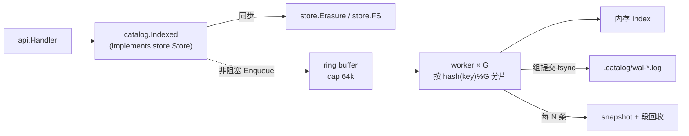

# gos3 · 元数据索引（Catalog）设计

> 对应 MinIO 商业版（AIStor）里的 **Catalog / Metadata Search**：对对象命名空间 + 系统元数据 +
> 用户元数据建二级索引，支持按属性检索、聚合和 `SELECT` 查询。免费版只有按 key 排序的
> `ListObjects`，任何"按大小/时间/类型/tag 查"的需求都会退化成全量遍历。
>
> 本文只写设计，不改现有 S3 语义：**对象数据路径不动，索引是旁挂的派生数据**。

---

## 1. 设计原则

| 原则 | 结论 | 理由 |
| --- | --- | --- |
| 事实来源 | sidecar JSON（`<root>/.meta/...`）是唯一真相 | 索引随时可丢、可重建，损坏不得影响 GET/PUT |
| 写路径 | **write-behind**：PUT 先落盘返回，事件入有界队列 | 元数据索引是 MinIO 的付费点，成本就在写放大；同步索引会把 PUT 延迟翻倍 |
| 失败语义 | 索引写失败只记 lag，不返回 5xx | 可用性优先，由 reconcile 补齐 |
| 一致性 | 单 key 事件按 seq 严格有序 apply；读侧不回表 | 同 key 的并发写已被 `lockObject` 串行化 |
| 分区 | 每个节点一份**全量**索引 | `writeMetaAll` 已把 meta 复制到所有盘，命名空间本就全量可得 |
| 存储 | 零新依赖：段式 WAL + 快照 + 内存索引 | 贴合"学习项目"目标；`Index` 接口预留换 Pebble |

明确不做：全文/向量检索、对象**内容**索引、跨桶 join、任意高基数元数据的等值索引。

---

## 2. 数据模型

索引文档 = **一个对象版本**（不是对象），与 `fsVersion` 一一对应，便于处理版本化与删除标记。

```go
// internal/catalog/doc.go
type Doc struct {
    Bucket       string
    Key          string
    VersionID    string
    IsLatest     bool
    DeleteMarker bool
    Size         int64
    ETag         string
    ContentType  string
    StorageClass string
    UserMeta     map[string]string // 仅白名单 key 建索引
    Tags         map[string]string
    ModTime      time.Time
    Seq          uint64            // 全局单调事件号，用于幂等与水位
}
```

主键（clustered）：`bucket \x00 key \x00 versionID`。
天然按 `(bucket, key)` 聚集、versionID 逆序，**顺带可以替代 `walkMetas` 的全目录遍历**来加速列举。

### 2.1 二级索引

```
idx.CT    bucket \x00 contentType \x00 key
idx.TIME  bucket \x00 modTimeUnixNano \x00 key
idx.SIZE  bucket \x00 sizeBucket \x00 key        // 分档而非精确值
idx.TAG   bucket \x00 tagKey \x00 tagValue \x00 key
idx.META  bucket \x00 metaKey \x00 metaValue \x00 key  // 仅白名单
```

关键的**基数控制**（这是整套设计最容易做错的地方）：

- `contentType`、`storageClass`、`tagKey`：低基数 → 建倒排。
- `size`：**分档**（`0,1K,1M,64M,1G,+`）建索引，精确比较在内存里做。避免每个不同字节数都写一条索引。
- `etag`、任意 user metadata：高基数 → **不建索引**，只能作为过滤谓词（候选集裁剪后在内存里判断）。
- 白名单由配置给出（默认 `x-amz-meta-owner`、`x-amz-meta-project` 之类），否则一个 `x-amz-meta-uuid` 就能把索引撑爆。

---

## 3. 存储布局

放在节点本地，**不进纠删码布局**（因为可重建，也不需要跨节点冗余）：

```
<data-dir-0>/.catalog/
  INDEX.json              # {gen, schemaVersion, appliedSeq, buckets[], createdAt}
  snapshot-0000123.snap   # 全量快照：按主键有序的 Doc 流（当前用 JSON Lines，后续可换 pb）
  wal-0000124.log         # 段文件，每条一行：{seq, op, bucket, key, versionId, doc?}
  wal-0000124.log.tmp     # 写入中（fsync 后 rename 才可见）
```

- 记录编码先用 JSON Lines：可 `tail`、可调试，和项目现有 sidecar 风格一致。
- **组提交**：worker 每 `K=256` 条或 `T=20ms` 做一次 `fsync`，把索引持久化成本摊薄。
- 段滚动：`wal` 超过 64MiB 或 10 万条 → 关闭当前段、把内存索引写新快照、删除老段。
- 快照复用现有 `writeJSONFile`（tmp + rename）的原子性思路。

### 3.1 恢复流程

```
load INDEX.json
  └─ 载入最新 snapshot → 重放 seq > snapshotSeq 的 WAL 段
       ├─ 记录 seq 连续 & 与 INDEX.appliedSeq 吻合 → 就绪
       └─ 出现 gap / 段缺失 / 主键冲突 → 标记 dirty，触发全量重建
全量重建 = 遍历 buckets 的 walkMetas()（已存在）→ 生成 Doc → 写新 gen 快照
```

重启恢复时间 ≈ 快照大小 + 未合并 WAL，量级在秒级；重建走的是后台低优先级 IO，带速率限制。

---

## 4. 摄取路径

用 **装饰器** 接在 `store.Store` 外面，而不是往 `fs.go` / `erasure.go` 里插代码：

```go
// internal/catalog/store.go
type Indexed struct {
    store.Store               // 内嵌，未覆盖的方法原样透传
    cat *Catalog
}

func (s *Indexed) PutObject(...) (store.ObjectInfo, error) {
    info, err := s.Store.PutObject(...)
    if err == nil {
        s.cat.Enqueue(Event{Op: OpPut, Info: info}) // 非阻塞
    }
    return info, err
}
```

覆盖点：`PutObject`、`DeleteObject`、`DeleteObjects`、`CompleteMultipartUpload`、
`DeleteBucket`、`AbortMultipartUpload`（无副作用，可忽略）。生命周期扫描器也走同一个
`store.Store`，因此**自动被覆盖，不需要额外埋点**。



- **有序性**：同一 key 必须落到同一 worker（`fnv(key) % G`），否则并发 put/delete 会乱序。
- **背压**：队列满 → 丢事件 + `dropped++` + 置 `lag=dirty`，由 reconcile 补齐。**永不阻塞 PUT**。
- **幂等**：apply 时 `if d.Seq <= appliedSeq { skip }`。

---

## 5. 查询面

### 5.1 管理 API（挂在 `/gos3/admin/`，root Basic auth）

```
GET  /gos3/admin/catalog/search
     ?bucket=&prefix=&contentType=&minSize=&maxSize=&after=&before=
     &meta.owner=alice&tag.env=prod&limit=100&token=<opaque>
GET  /gos3/admin/catalog/stats?bucket=&groupBy=contentType|storageClass|sizeBucket
POST /gos3/admin/catalog/sql      {"query":"SELECT key,size FROM S3Object WHERE size > 1048576 LIMIT 10"}
POST /gos3/admin/catalog/reindex  {"bucket":"photos","full":true}
GET  /gos3/admin/catalog/status   → {"docs":1234567,"appliedSeq":88,"lag":0,"dropped":0,"state":"ready"}
```

分页用 continuation token（base64 的主键 + seq），保证 **快照隔离**：token 里带 gen，
gen 变化即返回 `409 RestartQuery`，避免翻页时索引重建导致重复/遗漏。

### 5.2 查询规划

```
Filter(谓词集合)
  ├─ 选最 selective 的谓词 → 命中二级索引 → 候选主键集合（有序游标，不是全量物化）
  ├─ 剩余谓词 → 内存过滤（大小精确比较、etag、白名单外的 user meta）
  ├─ 排序（默认 bucket+key 升序；TIME 索引查询天然按时间有序）
  └─ 聚合（count / sum(size) / group by 低基数字段）
```

无索引可用时（例如只给了 `etag`）退化为 **bucket 全扫**，仍在服务端完成，比客户端遍历快一个数量级，
但要在响应头标记 `X-Gos3-Catalog-Scan: full`，让调用方知道贵。

### 5.3 SQL 子集

只支持 `SELECT <cols|*|count(*) FROM S3Object [WHERE ...] [LIMIT n]`，
`WHERE` 只允许 `AND` 连接的比较 / `LIKE`（前缀）/ `IN`。
**不写 SQL 引擎**：解析器直接产出上面的 `Filter`，SQL 只是查询 DSL 的语法糖。
这也正是 `mc sql` 对用户的心智模型。

---

## 6. 一致性与自愈

| 机制 | 触发 | 行为 |
| --- | --- | --- |
| 水位 | 每次 apply | 更新 `appliedSeq` / `lastEventAt` |
| 增量 reconcile | 默认 5m | 按 bucket 比对 `docCount(最新版本)` 与 sidecar 计数，偏差超阈值 → 该桶重建 |
| 全量重建 | 启动 dirty / 手动 / gen 失配 | `walkMetas()` → 新 gen 快照，旧索引继续服务直到切换（双缓冲） |
| 读侧校验 | 可选 `-catalog-verify` | 抽样回读 `StatObject` 比对 etag/mtime，仅用于排障 |

规则一句话：**冲突一律以 sidecar 为准，索引永远让步**。

---

## 7. 集群形态

因为 `writeMetaAll` 把对象 meta 写到**所有**盘的同一路径，每个节点本来就拥有完整命名空间：

```
节点1 [.catalog 全量]   节点2 [.catalog 全量]   节点3 [.catalog 全量]
        ↑ 查询打到任意节点，答案一致（允许存在秒级 lag 差异）
```

- 无需分片、无需分布式协调、无需 Raft。代价是索引写放大 ×N（只是元数据，可接受）。
- 新节点加入 → 后台 full rebuild，期间该节点查询返回 `503 + Retry-After`（或转发到已就绪节点，二选一）。
- 若未来 meta 改成分片存储，索引随之改为 **按 bucket hash 分片 + 查询 fan-out + 归并**，
  `Index` 接口与查询层不用动。

---

## 8. 包结构与骨架

```
internal/catalog/
  doc.go        # Doc / Key / Event / Filter / 结果类型
  index.go      # Index 接口 + memoryIndex（主键 map + 跳表式有序切片）
  wal.go        # 段式 WAL：Append / Replay / Rotate / Recover
  catalog.go    # Catalog：队列、worker、组提交、水位、reconcile、重建
  query.go      # Filter → plan → 执行 → 分页 token
  sql.go        # SELECT 子集解析 → Filter
  store.go      # Indexed 装饰器（实现 store.Store）
  api.go        # /gos3/admin/catalog/* handlers
```

CLI 开关（`internal/config`）：

```
-catalog              启用元数据索引（默认 true？建议默认 false，显式开启）
-catalog-dir          <data-dir-0>/.catalog
-catalog-workers      4
-catalog-reconcile    5m
-catalog-max-docs     0（0 = 不限；超限拒绝新 doc 并告警，防止内存打爆）
```

内存量级（doc ≈ 300 B 有效载荷，Go map/切片开销后约 600–800 B/doc）：

| 对象数 | 常驻内存（估算） |
| --- | --- |
| 10 万 | ~70 MB |
| 100 万 | ~700 MB |
| 1000 万 | 需要换 Pebble/Badger，或改列式紧凑编码 |

这是本方案最明确的边界，写进 `todo.md` 的"明确不做"里，别假装能扛十亿对象。

---

## 9. 里程碑（M8 · Catalog）

- [ ] **C1** `Doc`/`Index` 接口 + 内存实现 + 单测（主键、二级索引、删除标记、版本）
- [ ] **C2** WAL + snapshot + 恢复 + 全量重建（kill -9 后状态一致）
- [ ] **C3** `Indexed` 装饰器接入 + 异步 worker + 队列满降级
- [ ] **C4** `search` / `stats` / `status` API + console UI 的筛选侧栏
- [ ] **C5** `SELECT` 子集解析 + 计划选择
- [ ] **C6** reconcile / 多节点一致性 / 新节点 rebuild
- [ ] **C7**（可选）用索引替换 `ListObjects` 的 `walkMetas` 全目录遍历

依赖顺序：C1 → C2 → C3 → C4 →（C5 与 C6 并行）→ C7。

---

## 10. 与 MinIO 的对照

| 能力 | MinIO 免费版 | MinIO Catalog（付费） | gos3 本设计 |
| --- | --- | --- | --- |
| 列举 | prefix/delimiter，按 key 排序 | 同 | 同 |
| 按大小/时间/类型查 | 无（客户端全遍历） | 有 | 有 |
| 用户元数据/tag 检索 | 无 | 有（高基数也支持） | 仅白名单 key |
| SQL | `SELECT` 对象内容（S3 Select 系） | `SELECT` 元数据 | 仅元数据子集 |
| 聚合统计 | 无 | 有 | 有（count/sum/group by） |
| 一致性 | — | 近实时 | 异步 + 秒级 lag + reconcile |
